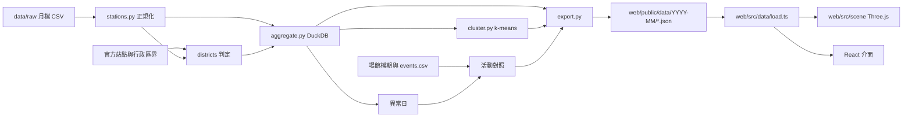

# Architecture Spine — 城市呼吸

> 2026-11-03 更新：配合 initiative replan（行政區流向、活動日、hallmark 移除），渲染改為 Three.js 微縮城市，資料契約升到 v2。`[ASSUMPTION]` 標記待 Piwi 確認。

## Design Paradigm

Pipes-and-filters：原始月檔與外部圖資、場館檔期 → 正規化 → 彙總 → 分群／異常／活動對照 → 匯出靜態 JSON。網站是唯讀的消費端，沒有後端，畫面是一個 Three.js 場景加上 React 介面。



依賴方向只能由左到右；`web/` 不得 import `pipeline/` 任何東西，兩邊只共用資料契約。

## Invariants & Rules

### AD-1 — 靜態資料契約是唯一介面 [ADOPTED]
- **Binds:** all
- **Prevents:** 前端各畫面各自處理原始資料、出現不同數字
- **Rule:** 網站只讀 `web/public/data/{month}/` 下的 JSON。每檔帶 `v`（契約版本），`load.ts` 版本不符就報錯。改欄位＝改 `docs/data-contract.md`＋`export.py`＋`types.ts`，三者同一個 commit。網站不向任何外部網址取資料或圖磚。

### AD-2 — 站名正規化只在管線
- **Binds:** 所有用到車站的功能
- **Prevents:** 「O景安／景安」「G大坪林／大坪林」被當成不同站
- **Rule:** 別名寫在 `pipeline/config/station_aliases.csv`；站 ID = `s` + sha1(正規站名) 前 8 碼。前端只用 ID 與陣列索引。

### AD-3 — 少於 10 人在管線端隱藏 [ADOPTED]
- **Binds:** R1、R2、R5、R13，任何起訖數字
- **Prevents:** 前端各自決定門檻、或從其他數字反推小數字
- **Rule:** 起訖平均、行政區起訖平均、活動日來源行政區的單日人數，四捨五入後 < 10 一律輸出 `null`，前端顯示「少於 10 人」。站層級總量（含逐日每站每小時）不受此限。

### AD-4 — 日型定義
- **Binds:** 平日／假日切換、所有平均
- **Prevents:** 管線與網站對同一天是平日或假日有不同判斷
- **Rule:** 週六、週日與 `config/holidays.csv` 列出的日子為 `holiday`，其餘為 `weekday`。假日表每月更新；異常候選（daily.json）可協助發現漏列的假日。

### AD-5 — 停止營運不是 0
- **Binds:** 所有小時陣列
- **Prevents:** 2–4 點被畫成「沒人」而不是「停駛」
- **Rule:** 小時陣列固定 24 格；資料中沒有的時段（目前 2–4 點）為 `null`，畫面顯示「停止營運」。

### AD-6 — 依需要載入
- **Binds:** 首頁、通勤卡、活動日
- **Prevents:** 首頁一次載入所有分片，手機卡頓
- **Rule:** 首頁只載 `stations.json`、`districts.json`、`district-flows.json`（合計目標 ≤ 300 KB）[ASSUMPTION]。`od/{stationId}.json` 在選了起站才載；`daily/{YYYY-MM-DD}.json` 在進入某一天才載。

### AD-7 — 平均的分母
- **Binds:** 所有平均值
- **Prevents:** 站與行政區用不同分母，加總對不起來
- **Rule:** 平均 = 該月該日型總人次 ÷ 該日型天數（沒人搭的日子算 0）。行政區平均由站的總人次先加總再除，不是把站平均相加。

### AD-8 — 視覺只走 token
- **Binds:** 所有畫面與場景材質
- **Prevents:** 介面與 3D 場景顏色各自寫死、日夜色票對不上
- **Rule:** 顏色、字型只透過 `:root` token；Three.js 材質顏色用 `tokenColor('--token')` 從 CSS 讀成 `THREE.Color`，不寫死。每個動畫有 reduced-motion 版本（不自動播放、直接切換）。設計流程見 CLAUDE.md（prototype 定方向、impeccable 打磨）。

### AD-9 — 行政區只在管線判定
- **Binds:** R3、R13、R5，任何以行政區呈現的數字
- **Prevents:** 首頁、通勤卡、活動日對同一站給出不同的行政區
- **Rule:** 管線用官方圖資（臺北市區界、內政部新北市區界）以站點座標判定每站行政區；需要人工修正的寫在 `pipeline/config/station_districts.csv`。行政區 ID 用內政部鄉鎮市區代碼。`stations.json` 每站帶 `district`，前端不得自己推算。

### AD-10 — 資料契約 v2 的檔案
- **Binds:** 管線 export.py、網站 load.ts、types.ts
- **Prevents:** 兩邊各自發明行政區、逐日、活動資料的檔案與形狀
- **Rule:** v2 在每月資料夾加入：
  - `districts.json`：行政區 ID、名稱、縣市、中心點、簡化多邊形。
  - `district-flows.json`：行政區×行政區×小時×日型的平均人次。
  - `daily/{YYYY-MM-DD}.json`：當日每站每小時進出，以及活動場館站的來源行政區×小時。
  - `events.json`：活動日清單。

  `flows.json`（前 200 組站弧線）在 v2 移除。欄位細節由 1.9、1.10 寫進 `docs/data-contract.md`。

### AD-11 — 場景用 Three.js
- **Binds:** 首頁、活動日、站點展開、任何地圖式畫面
- **Prevents:** 各畫面用不同的渲染技術與座標系統
- **Rule:** 場景用 Three.js＋React Three Fiber。站點與粒子用 `InstancedMesh`。不使用 maplibre-gl 與 deck.gl，不載外部底圖圖磚；城市底座（行政區形狀、河流）來自管線匯出或 `web/public` 的靜態幾何。

### AD-12 — 場景座標只有一個投影
- **Binds:** 所有場景圖層
- **Prevents:** 站點、行政區、弧線、粒子各自換算經緯度，彼此錯位
- **Rule:** `web/src/scene/projection.ts` 的 `project(lon, lat)` 是唯一的經緯度轉場景座標函式（固定原點與比例），所有圖層都經它；點選回推也只用它的反函式。

### AD-13 — 活動標註只在管線
- **Binds:** R5，任何顯示「那天發生什麼」的畫面
- **Prevents:** 網站各處對同一天給出不同原因，或前端自己猜原因
- **Rule:** 自動匯入的場館檔期（小巨蛋、花博、中山堂，來自臺北市資料大平臺）與人工的 `pipeline/config/events.csv` 在管線合併成 `events.json`。場館對應的車站寫在 `pipeline/config/venues.csv`。每筆帶日期、場館、名稱、來源（`auto` 或 `manual`＋網址）與 `verified`。異常日對不到活動就輸出「原因未查證」，前端照輸出顯示。

## Consistency Conventions

| Concern | Convention |
| --- | --- |
| 命名 | JSON 欄位 camelCase；Python snake_case；檔名 kebab／小寫 |
| 時間 | 月份 `YYYY-MM`；日期 ISO `YYYY-MM-DD`；小時 0–23 整數 |
| 站的參照 | 檔案內用 `stations.json` 的陣列索引；跨檔／URL 用站 ID |
| 行政區的參照 | 一律用內政部鄉鎮市區代碼，顯示名稱從 `districts.json` 取 |
| 文案 | 繁體中文；人數加千分位＋「人」；資料來源與月份須出現在分享卡與來源頁 |
| 錯誤 | 載入失敗顯示可讀訊息，不出現空白畫面；WebGL 不可用時顯示靜態說明與通勤入口 |

## Stack

| Name | Version |
| --- | --- |
| Python | ≥ 3.12（uv 管理） |
| DuckDB | 2.0.0 |
| scikit-learn | 1.9.1 |
| React | 19.3.1 |
| Vite | 8.3.5 |
| TypeScript | 7.0.2 |
| three | 0.186.1 |
| @react-three/fiber | 9.8.2 |
| @react-three/drei | 10.7.9 |
| Vitest | 5.0.5 |
| 部署 | Vercel 靜態網站 [ASSUMPTION] |

maplibre-gl 與 deck.gl 由 AD-11 移除；拿掉它們的時機在首頁換成場景的那張票（3.5）。

## Structural Seed

```text
city-breath/
  pipeline/            # Python 彙總管線（uv）
    config/            # 別名、假日、顯示名、車站類型、station_districts、venues、events
    src/city_breath_pipeline/
    tests/
  data/raw/            # 原始月檔、圖資、場館檔期快照（不進 git）
  web/                 # Vite + React 靜態網站
    public/data/       # 管線輸出（進 git，網站直接讀）
    src/data/          # 契約型別、載入、純運算（可測）
    src/scene/         # Three.js 場景、projection.ts、圖層
  docs/data-contract.md
```

## Capability → Architecture Map

| Capability | Lives in | Governed by |
| --- | --- | --- |
| R3 首頁行政區流向 | web/src/scene、districts.json、district-flows.json | AD-1、AD-5、AD-6、AD-8、AD-9、AD-11、AD-12 |
| R13 點行政區看去哪、誰來 | web/src/scene、district-flows.json、stations.json | AD-3、AD-7、AD-9 |
| R1／R2 通勤同路人卡 | web/src/data/commute.ts、od/{id}.json | AD-3、AD-6 |
| R4 車站個性卡 | pipeline/cluster.py、stations.json | AD-2、AD-4 |
| R5 活動日 | pipeline 活動對照、events.json、daily/{date}.json | AD-3、AD-4、AD-6、AD-13 |
| R11 資料來源頁 | web 靜態頁 | AD-1 |

## Deferred

- 搭乘站數與距離（R6 通勤負擔地圖，Parked）：臺北捷運票價表已有每組起訖距離，啟用時再加 `network.json`。
- 多月份（近 12 個月）彙總與月份切換：契約已有 `months.json`，UI 之後做（1.7）。
- 分享卡圖片輸出方式（canvas 繪製或 DOM 轉圖）：設計定稿後決定；需確認場景截圖與介面合成的做法。
- 每月自動重跑排程：先手動，穩定後再上 GitHub Actions；場館檔期的每月快照存在 `data/raw/`。
- 河流與城市底座幾何的來源與簡化程度：2.1 定案視覺時決定，只要經過 AD-12 的投影。
- 新北行政區界的確切來源與版本：1.8 開始時確認。
- 活動日來源行政區要涵蓋哪些站：1.10 開始時依 `venues.csv` 定。
