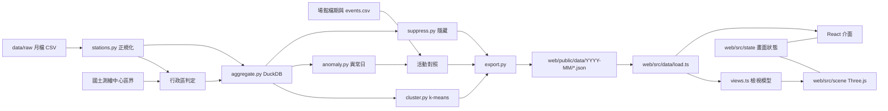

# Architecture Spine — 城市呼吸

> 2026-11-03 更新：配合 initiative replan（行政區流向、活動日、hallmark 移除），渲染改為 Three.js 微縮城市，資料契約升到 v2，並依兩份審查（reviews/）補上 AD-14 到 AD-20。`[ASSUMPTION]` 標記待 Piwi 確認。

## Design Paradigm

Pipes-and-filters：原始月檔、官方圖資、場館檔期 → 正規化 → 彙總 → 分群／異常／活動對照 → 隱藏小數字 → 匯出靜態 JSON。網站是唯讀的消費端，沒有後端，畫面是一個 Three.js 場景加上 React 介面，兩者共用一份畫面狀態。



依賴方向只能由左到右；`web/` 不得 import `pipeline/` 任何東西，兩邊只共用資料契約。

## Invariants & Rules

### AD-1 — 靜態資料契約是唯一介面 [ADOPTED]
- **Binds:** all
- **Prevents:** 前端各畫面各自處理原始資料、出現不同數字；出處標示不完整
- **Rule:** 網站只讀 `web/public/data/{month}/` 下的 JSON，不向任何外部網址取資料或圖磚（計數見 AD-20）。每檔帶 `v`（契約版本），`load.ts` 版本不符或缺 `v` 就報錯。改欄位＝改 `docs/data-contract.md`＋`export.py`＋`types.ts`，三者同一個 commit。每個輸入資料集都列在 `meta.json` 的 `sources[]`（名稱、機關、網址、授權、取得日期、sha256），資料來源頁只從這裡產生。

### AD-2 — 站名正規化只在管線，站的參照只有一種
- **Binds:** 所有用到車站的功能
- **Prevents:** 「O景安／景安」被當成不同站；不同檔案用不同方式指向同一站
- **Rule:** 別名寫在 `pipeline/config/station_aliases.csv`；站 ID = `s` + sha1(正規站名) 前 8 碼。JSON 裡指向車站的值一律是同一月份資料夾中 `stations.json` 的陣列索引（含 `daily/`、`od/`、`districts.json`、`events.json`）；站 ID 只出現在檔名、網址與 `stations.json` 本身。索引不跨月份使用；`load.ts` 讀任何分片時一併取得同月的 `stations.json` 並檢查 `month` 相同。

### AD-3 — 少於 10 人在管線端隱藏，含次要隱藏 [ADOPTED]
- **Binds:** R1、R2、R5、R13，任何起訖數字
- **Prevents:** 前端各自決定門檻；從公開的總量減出被隱藏的小數字
- **Rule:** 起訖平均、行政區起訖平均、活動日來源行政區的單日人數，四捨五入後 < 10 一律輸出 `null`，前端顯示「少於 10 人」。若某個已公開的總量等於一組格子的和（例：某起站各迄站之和＝該站進站量；各來源行政區之和＝該站該小時出站），而這組只有一格 `null`，就再隱藏組內最小的已公開格，直到每組有零格或至少兩格 `null`。只在 `pipeline/suppress.py` 實作，所有輸出都經過它，並逐組測試。站層級總量（含逐日每站每小時）不受 < 10 限制，但算作上述「已公開的總量」。

### AD-4 — 日型定義
- **Binds:** 平日／假日切換、所有平均
- **Prevents:** 管線與網站對同一天是平日或假日有不同判斷
- **Rule:** 週六、週日與 `config/holidays.csv` 列出的日子為 `holiday`，其餘為 `weekday`。假日表每月更新；AD-14 的全市級異常日可協助發現漏列的假日。

### AD-5 — 停止營運不是 0
- **Binds:** 所有小時陣列
- **Prevents:** 停駛被畫成「沒人」
- **Rule:** 小時陣列固定 24 格；月平均檔以全月都沒有紀錄的時段（目前 2–4 點）為 `null`，逐日檔以當日全市都沒有紀錄的小時為 `null`；畫面顯示「停止營運」。

### AD-6 — 依需要載入，場景有預算
- **Binds:** 首頁、通勤卡、活動日
- **Prevents:** 首頁一次載入所有分片；手機卡頓
- **Rule:** 首頁只載 `stations.json`、`districts.json`、`district-flows.json`（合計目標 ≤ 300 KB）[ASSUMPTION]。`od/{stationId}.json` 在選了起站才載；`daily/{YYYY-MM-DD}.json` 在進入某一天才載。場景預算：DPR ≤ 2、同時粒子 ≤ 3,000、中階 Android 30 fps 以上 [ASSUMPTION]。

### AD-7 — 平均的分母
- **Binds:** 所有平均值
- **Prevents:** 站與行政區用不同分母，加總對不起來
- **Rule:** 平均 = 該月該日型總人次 ÷ 該日型天數（沒人搭的日子算 0）。行政區平均由站的總人次先加總再除，不是把站平均相加。

### AD-8 — 視覺只走 token
- **Binds:** 所有畫面與場景材質
- **Prevents:** 介面與 3D 場景顏色各自寫死；日夜色票換了場景沒跟著換
- **Rule:** 顏色、字型只透過 `:root` token；Three.js 材質顏色經 `useTokenColor('--token')` 從 CSS 讀成 `THREE.Color`，不寫死、不自行快取。日夜相位由 AD-16 的 clock 決定並寫到 `:root` 的 `data-phase`，`useTokenColor` 訂閱相位變化重讀。每個動畫有 reduced-motion 版本：不自動播放、直接切換。設計流程見 CLAUDE.md（prototype 定方向、impeccable 打磨）。

### AD-9 — 行政區只在管線判定
- **Binds:** R3、R13、R5，任何以行政區呈現的數字
- **Prevents:** 首頁、通勤卡、活動日對同一站給出不同的行政區
- **Rule:** 行政區 ID＝國土測繪中心鄉鎮市區界的 8 碼代碼（字串，例如 `"63000010"`），臺北與新北用同一份界線，市府圖資只用來比對。判定用的座標就是 `stations.json` 匯出的 `lon/lat`，其他點位資料只拿來產生差異報告；人工修正寫在 `pipeline/config/station_districts.csv`。`districts.json` 的多邊形簡化後，管線檢查每站仍落在自己的區內，不在就降低簡化或報錯。`stations.json` 每站帶 `district`，前端不得自己推算。

### AD-10 — 資料契約 v2 的檔案
- **Binds:** 管線 export.py、網站 load.ts、types.ts
- **Prevents:** 兩邊各自發明行政區、逐日、活動資料的檔案與形狀
- **Rule:** v2 每月資料夾：
  - `districts.json`：行政區 ID、名稱、縣市、中心點、簡化多邊形、`inflowPartial`（區內有出站未入檔的環狀線站即為 `true`，顯示「誰來」時附固定說明）。
  - `district-flows.json`：行政區×行政區×小時×日型的平均人次。
  - `daily/{YYYY-MM-DD}.json`：當日每站每小時進出，以及 `venues.csv` 列出的場館站之來源行政區×小時。
  - `events.json`：形狀見 AD-14。

  `flows.json`（前 200 組站弧線）與 `daily.json` 在 v2 移除。擁有者：`districts.json`、`district-flows.json` 由 1.9 寫進 `docs/data-contract.md`；`daily/` 由 1.10；`events.json` 由 epic-event-days 的第一張票。

### AD-11 — 場景用 Three.js
- **Binds:** 首頁、活動日、站點展開、任何地圖式畫面
- **Prevents:** 各畫面用不同的渲染技術、渲染器或後製，接不起來
- **Rule:** 場景用 Three.js＋React Three Fiber，renderer 用 `WebGLRenderer`（R3F 預設）。後製用 `three/addons` 的 EffectComposer＋RenderPass＋UnrealBloomPass＋OutputPass，由單一 `useFrame(..., 1)` 接手渲染。站點與粒子用 `InstancedMesh`。不使用 maplibre-gl 與 deck.gl，不載外部底圖圖磚。WebGL 不可用時顯示靜態說明與通勤入口。

### AD-12 — 場景座標只有一個投影
- **Binds:** 所有場景圖層與地理資產
- **Prevents:** 站點、行政區、河流、弧線、粒子各自換算，彼此錯位
- **Rule:** `web/src/scene/projection.ts` 的 `project(lon, lat)` 是唯一的經緯度轉場景座標函式（固定原點與比例），點選回推只用它的反函式。地理資產（行政區、河流）以經緯度（GeoJSON）存放，執行時經 `project()`；若要預先投影，必須由讀取同一組常數的腳本產生，並有測試比對已知點。

### AD-13 — 活動標註只在管線
- **Binds:** R5，任何顯示「那天發生什麼」的畫面
- **Prevents:** 網站各處對同一天給出不同原因，或前端自己猜原因
- **Rule:** 自動匯入的場館檔期（小巨蛋、花博、中山堂，來自臺北市資料大平臺）與人工的 `pipeline/config/events.csv` 在管線合併成 `events.json`。場館對應的車站寫在 `pipeline/config/venues.csv`（由 1.10 建立，活動匯入只讀）。每筆帶起訖日、場館、車站、名稱、來源（`auto` 或 `manual`＋網址）與 `verified`。對不到活動的異常日照 AD-14 輸出，前端顯示「原因未查證」。

### AD-14 — 異常日與「平常」只有一個擁有者
- **Binds:** R5、AD-4、AD-13
- **Prevents:** 不同畫面對同一天是否異常、和平常差多少給出不同答案
- **Rule:** `pipeline/anomaly.py` 是唯一判定異常日與計算「平常」的地方。「平常」＝同月同星期幾、排除當日的中位數，站級與全市級同一定義。異常分兩層：全市級（全市進站差 ≥ 15%，也供假日檢查）與站級（門檻由活動匯入那張票定 [ASSUMPTION]）。結果只輸出在 `events.json`：`days[]`（`date`、`dayType`、`cityEntries`、`cityRatio`）、`anomalies[]`（`date`、`station`、`ratio`、`baseline`、`eventIds[]`，空陣列即「原因未查證」）、`events[]`（`id`、`startDate`、`endDate`、`venue`、`stations[]`、`name`、`source`、`url`、`verified`）。前端只查表，不比對日期區間。

### AD-15 — 小時一律是進站時段
- **Binds:** 所有小時陣列與時間軸
- **Prevents:** 不同畫面把同一格解讀成「出發」或「抵達」
- **Rule:** 小時 h 指「該趟在 h 點進站」，出站量也歸在進站時段。文案寫「h 點出發」，不寫「h 點抵達」；流向動畫在 h 這格從起點出發。資料來源頁說明這一點。

### AD-16 — 畫面狀態只有一份，網址是它的序列化
- **Binds:** R1、R2、R3、R4、R5、R13
- **Prevents:** 時間軸、行政區、站、活動日、通勤卡各存一份狀態，彼此不同步；分享連結各自拼
- **Rule:** `web/src/state/` 是唯一的畫面狀態：`month`、`dayType`、`hour`（整數）、`district`、`station`、`date`、`commute{o,d,h}`，元件與場景只透過它的 action 修改。播放用的連續時間 `t` 存在同一個 store 的非 React 欄位，由一個 clock 推進；場景在 `useFrame` 讀 `t`，React 只訂閱 `hour`。網址只用 query string，讀寫只在 `state/url.ts`；分享卡印的網址由同一個函式產生。

### AD-17 — 分享圖由資料重畫，不截場景
- **Binds:** R2、R5 的分享
- **Prevents:** 截 WebGL 畫面得到空白圖；分享卡與畫面各自排版
- **Rule:** 分享圖由 `web/src/share/render.ts` 依資料在離屏 canvas 重畫，不讀主場景的畫面緩衝；主場景 renderer 不開 `preserveDrawingBuffer`。顏色與字型照 AD-8 從 token 讀，繪製前等 `document.fonts.ready`。圖上的月份與來源取自 `meta.json`，網址取自 AD-16 的函式。

### AD-18 — 契約版本、月份資料與部署
- **Binds:** R10、所有月份資料夾、部署
- **Prevents:** 多月份混用不同契約版本；更正後使用者看到舊資料
- **Rule:** 網站一次只支援一個契約版本；升版的 PR 必須把 `web/public/data/` 下所有月份重建成新版本。CI 掃過所有 JSON 檢查 `v` 與 `CONTRACT_VERSION` 一致。月份資料夾上線後不可變，更正就整月重建並在 `meta.json` 加 `revision`。`web/public/data/**` 短快取（`max-age=300`），Vite 雜湊資源長快取，設定在 `vercel.json`。

### AD-19 — 場景圖層只吃檢視模型
- **Binds:** AD-11 所列的所有場景
- **Prevents:** 首頁與活動日各做一套流向圖層與粒子換算
- **Rule:** 場景圖層不 import 契約型別，只吃 `web/src/data/views.ts` 產生的檢視模型，例如 `FlowFrame`（`from`、`to` 為行政區 ID 或站索引，`value: number | null`）與 `StationFrame`。首頁、行政區展開、活動日都先轉成同一種 frame，共用同一個流向圖層與同一個人數→粒子數函式；`value` 為 `null` 時不畫粒子。

### AD-20 — 計數只有一個出口
- **Binds:** Done when 的成功指標、4.4
- **Prevents:** 各畫面各自接分析工具、事件名稱不一致、送出個人資料
- **Rule:** 只用 Vercel Web Analytics 的自訂事件（同網域，不載第三方腳本）[ASSUMPTION]，所有呼叫經 `web/src/track.ts` 的 `track(name, props)`。事件名稱固定：`commute_input_started`、`commute_result_shown`、`share_card_downloaded`、`station_opened`、`district_opened`、`event_day_opened`；props 不放可識別個人的值。

## Consistency Conventions

| Concern | Convention |
| --- | --- |
| 命名 | JSON 欄位 camelCase；Python snake_case；檔名 kebab／小寫 |
| 時間 | 月份 `YYYY-MM`；日期 ISO `YYYY-MM-DD`；小時 0–23 整數，意義見 AD-15 |
| 行政區的參照 | 一律用 AD-9 的 8 碼代碼字串，顯示名稱從 `districts.json` 取 |
| 文案 | 繁體中文；人數加千分位＋「人」；資料來源與月份須出現在分享卡與來源頁 |
| 錯誤 | 載入失敗顯示可讀訊息，不出現空白畫面 |
| 每月更新 | `fetch` → 補 `holidays.csv` 與 `events.csv` → 抓場館檔期快照到 `data/raw/` → `build` → 看全市級異常日與假日檢查、Piwi 定名新類型 → 開 PR、CI 通過後合併部署 |

## Stack

npm／PyPI 2026-11-03 查證。

| Name | Version |
| --- | --- |
| Python | ≥ 3.12（uv 管理） |
| DuckDB | 2.0.0 |
| scikit-learn | 1.9.1 |
| React | 19.3.1（R3F peer 限制 `<19.4`，升 minor 前先確認） |
| Vite | 8.3.5 |
| TypeScript | 7.0.2 |
| three | 0.186.1（0.187.0 於 2026-10-30 才發布，暫不升） |
| @types/three | 0.186.0（與 three 一起升） |
| @react-three/fiber | 9.8.2 |
| @react-three/drei | 10.7.9 |
| Vitest | 5.0.5 |
| 部署 | Vercel 靜態網站＋Web Analytics [ASSUMPTION] |

maplibre-gl 與 deck.gl 由 AD-11 移除；拿掉它們的時機在首頁換成場景的那張票（3.5）。

## Structural Seed

```text
city-breath/
  pipeline/            # Python 彙總管線（uv）
    config/            # 別名、假日、顯示名、車站類型、station_districts、venues、events
    src/city_breath_pipeline/   # stations、aggregate、cluster、anomaly、suppress、export
    tests/
  data/raw/            # 原始月檔、區界圖、場館檔期快照（不進 git）
  web/                 # Vite + React 靜態網站
    public/data/       # 管線輸出（進 git，網站直接讀）
    src/data/          # 契約型別、載入、views.ts 檢視模型、純運算（可測）
    src/state/         # 畫面狀態與 url.ts
    src/scene/         # Three.js 場景、projection.ts、圖層
    src/share/         # 分享圖重畫
    src/track.ts       # 計數
  docs/data-contract.md
  vercel.json
```

## Capability → Architecture Map

| Capability | Lives in | Governed by |
| --- | --- | --- |
| R3 首頁行政區流向 | web/src/scene、views.ts、districts.json、district-flows.json | AD-1、AD-5、AD-6、AD-8、AD-9、AD-11、AD-12、AD-15、AD-16、AD-19 |
| R13 點行政區看去哪、誰來 | web/src/scene、district-flows.json、stations.json | AD-3、AD-7、AD-9、AD-10、AD-16 |
| R1／R2 通勤同路人卡 | web/src/data/commute.ts、od/{id}.json、web/src/share | AD-3、AD-6、AD-16、AD-17、AD-20 |
| R4 車站個性卡 | pipeline/cluster.py、stations.json | AD-2、AD-4 |
| R5 活動日 | pipeline/anomaly.py、events.json、daily/{date}.json | AD-3、AD-4、AD-6、AD-13、AD-14、AD-19 |
| R10 每月管線 | pipeline/、data/raw/、web/public/data/ | AD-1、AD-18、每月更新 |
| R11 資料來源頁 | web 靜態頁、meta.json | AD-1、AD-15 |

## Deferred

- 搭乘站數與距離（R6 通勤負擔地圖，Parked）：臺北捷運票價表已有每組起訖距離，啟用時再加 `network.json`。
- 多月份（近 12 個月）的月份切換 UI：契約已有 `months.json`，1.7 之後做；受 AD-18 約束。
- 每月更新的自動化（GitHub Actions 排程）：先照 Conventions 手動，連續三個月穩定後再做。
- 資料量與 git 歷史：每月約 3–4 MB 進 git；12 個月後評估改用 Git LFS 或部署時下載。
- 河流與城市底座幾何的來源與簡化程度：2.1 定案視覺時決定，受 AD-12 約束。
- 國土測繪中心鄉鎮市區界的確切版本與欄位名：1.8 開工時對實際檔案確認。
- 站級異常門檻：epic-event-days 的活動匯入票決定，寫回 AD-14。
