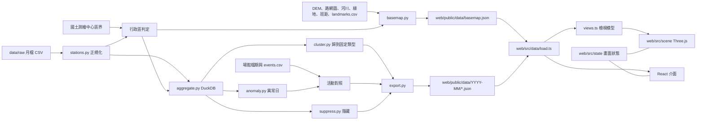

# Architecture Spine — 城市呼吸

> 2026-11-03 更新：配合 initiative replan（行政區流向、活動日、hallmark 移除），渲染改為 Three.js 微縮城市，資料契約升到 v2，並依兩份審查（reviews/）補上 AD-14 到 AD-20。2026-11-10 更新：2.1 定案天光（DESIGN.md），加上底圖檔（AD-21）、唯一的持久化狀態（AD-22）、示意物件（AD-23）、音效（AD-24）、地標（AD-25）、站的特質與徽章（AD-26），並改寫 AD-8、AD-11 的光照與 AD-12 的高程。2026-11-11 更新：1.6 車站類型改成固定類型、每月歸類（AD-27）；同日依 Piwi 的決定，AD-10 加契約 v4 的行政區總量（3.20），AD-22 加最近用過的站（4.1），AD-18 補預覽部署與分享網址的網域，AD-6 註明實測時機。2026-11-14 更新（產品計畫 v2 與搭乘模式第 0 期）：AD-4、AD-7 加停班停課日，AD-10 排 v5／v6，AD-27 加整年最常見的型，AD-16 加搭乘狀態，AD-20 加複製連結事件，AD-22 改成四樣可保存的東西，AD-6、AD-11、AD-18 與 Conventions 補上真機量測、搭乘鏡頭、連結預覽、冒煙測試與每月一個指令。`[ASSUMPTION]` 標記待 Piwi 確認。

## Design Paradigm

Pipes-and-filters：原始月檔、官方圖資、底圖原始檔、場館檔期 → 正規化 → 彙總 → 分群／異常／活動對照 → 隱藏小數字 → 匯出靜態 JSON。網站是唯讀的消費端，沒有後端，畫面是一個 Three.js 場景加上 React 介面，兩者共用一份畫面狀態。



依賴方向只能由左到右；`web/` 不得 import `pipeline/` 任何東西，兩邊只共用資料契約。

## Invariants & Rules

### AD-1 — 靜態資料契約是唯一介面 [ADOPTED]
- **Binds:** all
- **Prevents:** 前端各畫面各自處理原始資料、出現不同數字；出處標示不完整
- **Rule:** 網站只讀 `web/public/data/` 下的 JSON（`months.json`、不分月份的 `basemap.json`、`{month}/` 資料夾），不向任何外部網址取資料、圖磚、地形或音檔（計數見 AD-20）。每檔帶 `v`（契約版本），`load.ts` 版本不符或缺 `v` 就報錯。改欄位＝改 `docs/data-contract.md`＋`export.py`＋`types.ts`，三者同一個 commit。每個輸入資料集都列在 `meta.json` 或 `basemap.json` 的 `sources[]`（同一形狀：名稱、機關、網址、授權、取得日期、sha256），資料來源頁只從這兩處產生。

### AD-2 — 站名正規化只在管線，站的參照只有一種
- **Binds:** 所有用到車站的功能
- **Prevents:** 「O景安／景安」被當成不同站；不同檔案用不同方式指向同一站
- **Rule:** 別名寫在 `pipeline/config/station_aliases.csv`；站 ID = `s` + sha1(正規站名) 前 8 碼。JSON 裡指向車站的值一律是同一月份資料夾中 `stations.json` 的陣列索引（含 `daily/`、`od/`、`districts.json`、`events.json`）；站 ID 只出現在檔名、網址與 `stations.json` 本身。索引不跨月份使用；`load.ts` 讀任何分片時一併取得同月的 `stations.json` 並檢查 `month` 相同。例外：不分月份的 `basemap.json`（AD-21）以站 ID 指涉車站，前端用目前月份的 `stations.json` 換成索引，當月沒有的站略過。

### AD-3 — 少於 10 人在管線端隱藏，含次要隱藏 [ADOPTED]
- **Binds:** R1、R2、R5、R13，任何起訖數字
- **Prevents:** 前端各自決定門檻；從公開的總量減出被隱藏的小數字；拿 git 歷史裡的舊版數字加上新版的總量，減出兩版都隱藏的格（跨版本反推）
- **Rule:** 起訖平均、行政區起訖平均、活動日來源行政區的單日人數，四捨五入後 < 10 一律輸出 `null`，前端顯示「少於 10 人」。若某個已公開的總量等於一組格子的和（例：某起站各迄站之和＝該站進站量；各來源行政區之和＝該站該小時出站），而這組只有一格 `null`，就再隱藏組內最小的已公開格，直到每組有零格或至少兩格 `null`。**已公開過的格不再新藏**（2026-11-10，Piwi 決定）：repo 是公開的，舊版的數字留在 git 歷史，新版若把舊格改成 `null`，舊值加上新版的總量反而能減出別的隱藏格。所以新版本新增的格（v3：inbound 的來源區格，以及 v2 沒公開過的全日格；v2 的 topDestinations 前 5 算舊格）與舊格同組時，只在新格裡挑來藏，並先挑「藏了不會逼別組改藏舊格」的那格；組內沒有新格才照「最小的已公開格」藏舊格。實在避不開的舊格（新格都藏了仍有組只剩一格 `null`）列在 `pipeline/tests/fixtures/od_v2_exceptions.json`，測試確認 od 分片相對 v2 不會多出其他 `null`。只在 `pipeline/suppress.py` 實作，所有輸出都經過它，並逐組測試。站層級總量（含逐日每站每小時）不受 < 10 限制，但算作上述「已公開的總量」。

### AD-4 — 日型定義
- **Binds:** 平日／假日切換、所有平均
- **Prevents:** 管線與網站對同一天是平日或假日有不同判斷
- **Rule:** 週六、週日與 `config/holidays.csv` 列出的日子為 `holiday`；停班停課日（颱風假等，行政院人事行政總處公告，以臺北市為準；清單在 `pipeline/config/`，每列附公告網址）為 `closure`，不算 `weekday` 也不算 `holiday`（產品計畫 v2 決定 27，1.14 起）；其餘為 `weekday`。日型只在管線判定，`events.json` 的 `days[].dayType` 照此輸出，前端只查表。假日表與停班停課日每月更新；AD-14 的全市級異常日可協助發現漏列的日子。

### AD-5 — 停止營運不是 0
- **Binds:** 所有小時陣列
- **Prevents:** 停駛被畫成「沒人」
- **Rule:** 小時陣列固定 24 格；月平均檔以全月都沒有紀錄的時段（目前 2–4 點）為 `null`，逐日檔以當日全市都沒有紀錄的小時為 `null`；畫面顯示「停止營運」。

### AD-6 — 依需要載入，場景有預算
- **Binds:** 首頁、通勤卡、活動日
- **Prevents:** 首頁一次載入所有分片；手機卡頓
- **Rule:** 首頁的資料 JSON 與 three／R3F 分包同時開始載入，不一先一後（6.2）。首頁只載 `stations.json`、`districts.json`、`district-flows.json`（合計目標 ≤ 300 KB）[ASSUMPTION]，以及 `basemap.json`（目標 ≤ 1 MB 未壓縮）[ASSUMPTION]。`od/{stationId}.json` 在選了起站才載、`inbound/{stationId}.json` 在打開車站卡的「誰來」才載；`daily/{YYYY-MM-DD}.json` 在進入某一天才載。場景預算：DPR ≤ 2、同時粒子 ≤ 3,000、中階 Android 30 fps 以上 [ASSUMPTION]；街廓、樹、列車、站柱都用 InstancedMesh。效能面板 `?debug=perf` 只在帶這個參數時動態載入，不進 AD-16 的狀態、網址與 `track()`。預算的第一次實機量測是 6.4（關卡 1：iPhone 與一支中階 Android、5 個情境各 30 秒，平均 30 fps 以上），搭乘模式在 8.6 再量（關卡 A）；不達標開新票。後加的資料一律用到才載（決定 29）。

### AD-7 — 平均的分母
- **Binds:** 所有平均值
- **Prevents:** 站與行政區用不同分母，加總對不起來
- **Rule:** 平均 = 該月該日型總人次 ÷ 該日型天數（沒人搭的日子算 0）。`closure` 日（AD-4）不進 `weekday`、`holiday` 的總人次與天數，也不進 AD-14「平常」的中位數。行政區平均由站的總人次先加總再除，不是把站平均相加。

### AD-8 — 視覺只走 token
- **Binds:** 所有畫面與場景材質
- **Prevents:** 介面與 3D 場景顏色各自寫死；日夜色票換了場景沒跟著換；有的圖層換色、有的靠光，日夜不一致
- **Rule:** 顏色、字型只透過 `:root` token；Three.js 材質顏色經 `useTokenColor('--token')` 從 CSS 讀成 `THREE.Color`，不寫死、不自行快取。天光（DESIGN.md）：材質顏色 token 不分相位、整天固定；只有天空、光、環境光與 HUD 的 token 有 `-night`／`-dawn`／`-day`／`-dusk` 四組，在 DESIGN.md 的關鍵時刻於相鄰兩組間內插。相位的關鍵時刻與內插只在 `web/src/scene/daylight.ts` 定義：AD-16 的 clock 用它的 `phaseAt(t)` 把相位寫到 `:root` 的 `data-phase`（HUD 用），場景用它算光色（見 AD-11）。每個動畫有 reduced-motion 版本：不自動播放、直接切換。設計流程見 CLAUDE.md（prototype 定方向、impeccable 打磨）。

### AD-9 — 行政區只在管線判定
- **Binds:** R3、R13、R5，任何以行政區呈現的數字
- **Prevents:** 首頁、通勤卡、活動日對同一站給出不同的行政區
- **Rule:** 行政區 ID＝國土測繪中心鄉鎮市區界的 8 碼代碼（字串，例如 `"63000010"`），臺北與新北用同一份界線，市府圖資只用來比對。判定用的座標就是 `stations.json` 匯出的 `lon/lat`，其他點位資料只拿來產生差異報告；人工修正寫在 `pipeline/config/station_districts.csv`。`districts.json` 的多邊形簡化後，管線檢查每站仍落在自己的區內，不在就在該站周邊局部保留原始界線、降低簡化，或報錯。界線取自國土測繪中心全國村里界，依 8 碼代碼合併成鄉鎮市區（來源與 sha256 在 `pipeline/config/geo_sources.csv`）。`stations.json` 每站帶 `district`，前端不得自己推算。

### AD-10 — 資料契約 v2 的檔案
- **Binds:** 管線 export.py、網站 load.ts、types.ts
- **Prevents:** 兩邊各自發明行政區、逐日、活動資料的檔案與形狀
- **Rule:** v2 每月資料夾：
  - `districts.json`：行政區 ID、名稱、縣市、中心點、簡化多邊形、`inflowPartial`（區內有出站未入檔的環狀線站即為 `true`，顯示「誰來」時附固定說明）。
  - `district-flows.json`：行政區×行政區×小時×日型的平均人次。
  - `daily/{YYYY-MM-DD}.json`：當日每站每小時進出，以及 `venues.csv` 列出的場館站之來源行政區×小時。
  - `events.json`：形狀見 AD-14。

  `flows.json`（前 200 組站弧線）與 `daily.json` 在 v2 移除。擁有者：`districts.json`、`district-flows.json` 由 1.9 寫進 `docs/data-contract.md`；`daily/` 由 1.10；`events.json` 由 epic-event-days 的第一張票。

  v3（1.13 起）：
  - `inbound/{stationId}.json`：該迄站每日型每小時前 5 起站與各來源行政區的平均人次、整天前 10 起站；起站格與 od 分片是同一批經 `suppress.py` 的格子，值必須相同；環狀線站沒有這個分片。
  - `stations.json` 的 `topDestinations` 由前 5 擴成前 10。
  - 7.6 在 `events.json` 加每小時平常與場館周邊站（AD-14）；與 1.13 同期就併入 v3，否則再升一版。

  v4（3.20 起）：
  - `districts.json` 每區加 `weekday`／`holiday` 的 `{ entries[24], exits[24] }`：照 AD-7，區內各站當月整數總人次先加總、再除該日型天數、四捨五入；停止營運為 `null`（AD-5）；`exits` 只算出站有紀錄的站，`inflowPartial` 的區少算。這些就是 `suppress.py` 行政區列、欄組已當作公開的總量，不新增隱藏組、不改任何已公開的格（AD-3）。前端的區排名只讀這兩個陣列，不把 `stations.json` 的站平均相加。
  - v5（1.14 起）：`dayType` 多一個值 `closure`（AD-4、AD-7），`meta.json` 記各日型天數；沒有停班停課日的月份除 `v` 外逐格相同。
  - v6（7.6 起）：`events.json` 加每小時平常與場館周邊站（AD-14）。7.6 排在 1.14 之後，兩次升版不會同時改。

  不分月份的 `basemap.json` 見 AD-21。

### AD-11 — 場景用 Three.js
- **Binds:** 首頁、活動日、站點展開、任何地圖式畫面
- **Prevents:** 各畫面用不同的渲染技術、渲染器或後製，接不起來
- **Rule:** 場景用 Three.js＋React Three Fiber，renderer 用 `WebGLRenderer`（R3F 預設），NeutralToneMapping。光照照天光：太陽東升西落、正午在南、夜裡換月光，只有這一盞方向光投影（PCF 陰影）；太陽／月亮方位、光色、環境光與曝光（夜 0.78 到日 1.0）只在 `web/src/scene/daylight.ts` 從 clock 的時刻算出，夜裡亮的是窗、站珠、列車的自發光。天光不用後製；之後要加，只能用 `three/addons` 的 EffectComposer，由單一 `useFrame(..., 1)` 接手渲染。站點、粒子、光膠囊、街廓、樹、列車與地標積木用 `InstancedMesh`，捷運路線與少量重點弧線用 Line2 或 Tube。鏡頭用 drei 的 `<CameraControls>`。搭乘模式（8.6）的鏡頭也是這一個 `<CameraControls>`：路徑取 `basemap.json` 的軌道經 `project()` 與 `elevation()`（AD-12），標 `approx` 的段不當成真實沿線；不另建第二個鏡頭或 renderer。一次性動作（點選彈跳、抽屜、數字跳動）只用 GSAP，播放由 AD-16 的 clock 推進；動畫只改畫面、不存狀態，狀態改變時打斷重來。手感細則見專案 skill `diorama-game-juice`。不使用 maplibre-gl、deck.gl 與 pmndrs/postprocessing，不載外部底圖圖磚。WebGL 不可用時顯示靜態說明與通勤入口。

### AD-12 — 場景座標只有一個投影
- **Binds:** 所有場景圖層與地理資產，含地形高程
- **Prevents:** 站點、行政區、河流、弧線、粒子各自換算，彼此錯位；地形、站、街廓用不同的垂直誇張，站浮在山上或埋進地裡
- **Rule:** `web/src/scene/projection.ts` 的 `project(lon, lat)` 是唯一的經緯度轉場景座標函式（固定原點與比例），點選回推只用它的反函式。地理資產（行政區、河流）以經緯度（GeoJSON）存放，執行時經 `project()`；若要預先投影，必須由讀取同一組常數的腳本產生，並有測試比對已知點。高程：`basemap.json` 一律存公尺；`projection.ts` 匯出 `TERRAIN_EXAGGERATION`（1.5，Piwi 2026-11-11 由 2 調低）與 `elevation(m)`，是唯一把真實高程換成場景高度的函式；地形等級查詢 `terrainLevelAt(lon, lat)` 讀 basemap 的等級格網，也放在 `projection.ts`。站柱、建築、緞帶等由人數決定的高度不是高程，不經 `elevation()`，比例在 `views.ts`；它們的基座高度才取 `elevation()`。

### AD-13 — 活動標註只在管線
- **Binds:** R5，任何顯示「那天發生什麼」的畫面
- **Prevents:** 網站各處對同一天給出不同原因，或前端自己猜原因
- **Rule:** 自動匯入的場館檔期（小巨蛋、花博、中山堂，來自臺北市資料大平臺）與人工的 `pipeline/config/events.csv` 在管線合併成 `events.json`。場館對應的車站寫在 `pipeline/config/venues.csv`（由 1.10 建立，活動匯入只讀）。每筆帶起訖日、場館、車站、名稱、來源（`auto` 或 `manual`＋網址）與 `verified`。對不到活動的異常日照 AD-14 輸出，前端顯示「原因未查證」。

### AD-14 — 異常日與「平常」只有一個擁有者
- **Binds:** R5、AD-4、AD-13
- **Prevents:** 不同畫面對同一天是否異常、和平常差多少給出不同答案
- **Rule:** `pipeline/anomaly.py` 是唯一判定異常日與計算「平常」的地方。「平常」＝同月同星期幾、排除當日的中位數，站級與全市級同一定義。異常分兩層：全市級（全市進站差 ≥ 15%，也供假日檢查）與站級（進站或出站 ≥ 平常的 1.3 倍、多出 ≥ 1,000 人，且該站整月「當日÷平常」的 modified z-score ≥ 3.5；z 條件排除開學等整段偏移）。結果只輸出在 `events.json`：`days[]`（`date`、`dayType`、`cityEntries`、`cityRatio`）、`anomalies[]`（`date`、`station`（全市級為 `null`）、`measure`（`entries` 或 `exits`）、`ratio`、`baseline`、`eventIds[]`，空陣列即「原因未查證」）、`events[]`（`id`、`startDate`、`endDate`、`venue`、`stations[]`、`name`、`source`、`url`、`verified`）。頂層 `thresholds` 記錄當次使用的門檻。活動卡用的每小時「平常」與場館周邊站（1.5 公里內最近 5 站）也由 `anomaly.py` 依同一定義輸出在 `events.json`（7.6）。前端只查表，不比對日期區間、不拿月平均當「平常」、不自己依距離找周邊站。

### AD-15 — 小時一律是進站時段
- **Binds:** 所有小時陣列與時間軸
- **Prevents:** 不同畫面把同一格解讀成「出發」或「抵達」
- **Rule:** 小時 h 指「該趟在 h 點進站」，出站量也歸在進站時段。文案寫「h 點出發」，不寫「h 點抵達」；流向動畫在 h 這格從起點出發。資料來源頁說明這一點。

### AD-16 — 畫面狀態只有一份，網址是它的序列化
- **Binds:** R1、R2、R3、R4、R5、R13
- **Prevents:** 時間軸、行政區、站、活動日、通勤卡各存一份狀態，彼此不同步；分享連結各自拼
- **Rule:** `web/src/state/` 是唯一的畫面狀態：`month`、`dayType`、`hour`（整數）、`district`、`station`、`date`、`commute{o,d,h}`、`ride{line, station}`（搭乘模式 8.6：搭哪條線、停在或剛過哪一站），元件與場景只透過它的 action 修改。播放用的連續時間 `t` 與搭乘中兩站之間的連續位置存在同一個 store 的非 React 欄位，由一個 clock 推進；場景在 `useFrame` 讀 `t`，React 只訂閱 `hour`。網址只用 query string，讀寫只在 `state/url.ts`；分享卡印的網址由同一個函式產生；搭乘中只在暫停或到站時寫網址。唯一跨工作階段保存的狀態見 AD-22，其他畫面狀態（圖層開關、音效、目前選的站與行政區）不保存。

### AD-17 — 分享圖由資料重畫，不截場景
- **Binds:** R2、R5、R17 的分享（通勤卡、行政區卡、活動卡）
- **Prevents:** 截 WebGL 畫面得到空白圖；分享卡與畫面各自排版
- **Rule:** 分享圖由 `web/src/share/render.ts` 依資料在離屏 canvas 重畫，不讀主場景的畫面緩衝；主場景 renderer 不開 `preserveDrawingBuffer`。顏色與字型照 AD-8 從 token 讀，繪製前等 `document.fonts.ready`。圖上的月份與來源取自 `meta.json`，網址取自 AD-16 的函式（只印短網址，不放 QR code）。三種卡共用 `render.ts` 的同一個直式版型，只換內容區；數字與英文用放在 `web/public/` 的自帶字型子集（不向外部載入，AD-1；授權列進來源清單），中文用系統字型（決定 19，3.15）。

### AD-18 — 契約版本、月份資料與部署
- **Binds:** R10、所有月份資料夾、部署
- **Prevents:** 多月份混用不同契約版本；更正後使用者看到舊資料
- **Rule:** 網站一次只支援一個契約版本；升版的 PR 必須把 `web/public/data/` 下所有月份與 `basemap.json` 重建成新版本。CI 掃過所有 JSON 檢查 `v` 與 `CONTRACT_VERSION` 一致。月份資料夾上線後不可變，更正就整月重建並在 `meta.json` 加 `revision`。`web/public/data/**` 短快取（`max-age=300`），Vite 雜湊資源長快取，設定在 `vercel.json`。部署只從 `main` 到 Vercel（PR 的 Preview 部署只供審查）；6.2 預覽部署（`*.vercel.app`）到 6.3 正式上線之間，`vercel.json` 對整站送 `X-Robots-Tag: noindex` [ASSUMPTION]，6.3 拿掉。分享網址只由 `state/url.ts` 依目前網址的 origin 產生，不寫死網域；綁自訂網域後保留 `*.vercel.app`，預覽期分享出去的連結仍打得開。連結預覽（Open Graph、Twitter card，全站一張固定圖，決定 20）需要絕對網址：建置時由環境變數 `VITE_SITE_URL` 寫進 `index.html`，沒設時用相對路徑；這是網址唯一不經 `url.ts` 的地方，只用於預覽標籤。CI 有 `web/e2e/` 的瀏覽器冒煙測試（6.5），截圖存成 CI 產物，畫面對照都用它。

### AD-19 — 場景圖層只吃檢視模型
- **Binds:** AD-11 所列的所有場景
- **Prevents:** 首頁與活動日各做一套流向圖層與粒子換算
- **Rule:** 場景圖層不 import 契約型別，只吃 `web/src/data/views.ts` 產生的檢視模型，例如 `FlowFrame`（`from`、`to` 為行政區 ID 或站索引，`value: number | null`）與 `StationFrame`。首頁、行政區展開、活動日都先轉成同一種 frame，共用同一個流向圖層與同一個人數→粒子數函式；`value` 為 `null` 時不畫粒子。

### AD-20 — 計數只有一個出口
- **Binds:** Done when 的成功指標、4.4
- **Prevents:** 各畫面各自接分析工具、事件名稱不一致、送出個人資料
- **Rule:** 只用 Vercel Web Analytics 的自訂事件（同網域，不載第三方腳本）[ASSUMPTION]，所有呼叫經 `web/src/track.ts` 的 `track(name, props)`。事件名稱固定：`commute_input_started`、`commute_result_shown`、`share_card_downloaded`（props `kind`：`commute`、`district`、`event`）、`share_link_copied`（props `kind`：開著的卡，`station`、`district`、`commute`、`event`，沒開卡為 `home`）、`station_opened`、`district_opened`、`event_day_opened`；props 不放可識別個人的值。`track.ts` 與事件名由 6.2 建立，各畫面在自己的票呼叫，4.4 驗證進後台。北極星＝`share_card_downloaded`＋`share_link_copied`；領先指標「找到自己」＝送過 `station_opened` 或 `commute_result_shown` 的訪客比例。

### AD-21 — 底圖只有一個檔，由管線產生
- **Binds:** R20、2.3 與所有場景圖層、資料來源頁
- **Prevents:** 前端或原型各自抓地形、河川、軌道，兩份底圖對不起來；底圖來源不在來源頁；底圖改了沒人知道
- **Rule:** 底圖只有 `web/public/data/basemap.json`，不分月份，只由管線（`city-breath fetch-basemap` 下載到 `data/raw/basemap/`，網址、取得日期、sha256 記在 `pipeline/config/basemap_sources.csv`；`build` 產生）。內容：地形六層台地（40／120／250／400／600／850 公尺，存公尺）與高程等級格網、海與底座外的河、依行政區切開的河川與綠地、捷運軌道（路網圖缺段以直線補並標 `approx`）、每站所屬路線（站 ID，AD-2）、各線平日／假日每小時班距（營運外 `null`）、地標（AD-25）、`sources[]`。路線 ID 固定為 `BR`、`R`、`R-3`、`G`、`G-3`、`O`、`BL`、`Y`，顏色只走 token `--line-` 加小寫、去連字號的 ID（`R-3` → `--line-r3`），JSON 裡不放色碼。幾何一律經緯度（AD-12）。檔案帶 `v`＝`CONTRACT_VERSION` 與 `basemapRevision`：新增這個檔本身不升版（現有檔案不變）；改形狀照 AD-18 升版；只換內容（新的 DEM、河道）加 `basemapRevision`。只用標明開放授權的來源；新北河川用水利署河川河道（data.gov.tw 25781）。契約寫在 `docs/data-contract.md`。

### AD-22 — 唯一跨工作階段保存的狀態
- **Binds:** 提示（3.11）、找你的站的最近用過的站（4.1）、我的站（3.23）、徽章（8.3）
- **Prevents:** 各功能各自寫 localStorage、鍵名打架；隱私模式或封鎖儲存時畫面壞掉；保存的東西偷偷進網址、分享卡或計數
- **Rule:** 只有四樣可以跨工作階段保存：看過的提示（提示 ID 清單，一次一條，3.11）；找你的站的「最近用過的站」（Piwi 2026-11-11：最多 5 個站 ID，新的在前、不重複；站 ID 見 AD-2，跨月份通用；不存人數、時段、起訖組合或任何數字；讀出時略過目前月份 `stations.json` 沒有的站）；「我的站」（3.23：一個站 ID 與已經看過「你的站這個月…」的月份，不存任何人數）；徽章進度（依月份記已解鎖的徽章 ID，8.3）。四樣都只在 `web/src/state/progress.ts` 讀寫 localStorage 的同一個鍵 `city-breath:progress:v1`（4.1 與 3.11 中先上線的建立這個模組，後來的票加欄位，不另開鍵）；每次寫入都讀出整個物件、只改自己那一欄再寫回，不認得的欄位原樣保留，某一欄壞了只把那一欄當空的。每次讀寫包在 try/catch；不可用、讀到壞資料或寫入失敗時退回記憶體，畫面照常運作（只是不保存）。它不進網址、不進分享卡、不送 `track()`。這是 AD-16 唯一的例外。

### AD-23 — 示意物件不承載資料數字
- **Binds:** 街廓、樹、列車、雲、地標造型（3.8、3.13、3.14）、圖例、資料來源頁
- **Prevents:** 使用者把建築高度、樹的多寡、列車位置當成真實數字；示意物件被做成可點出數字
- **Rule:** 示意物件可以由資料決定疏密、高度或間隔（附近車站人數、班距），但不顯示數字、點了不出數字（地標點了開的是那站的資料卡，數字來自 `stations.json`）、不進分享卡；圖例或資料來源頁標明它們是示意。列車只在該線該小時班距有值時出現，環狀線沒有班距就不畫。數字只出現在由契約資料算出的卡片、標籤與圖例。

### AD-24 — 音效預設關閉、不載音檔
- **Binds:** 所有回饋音效
- **Prevents:** 打開網頁就出聲；為了音效多載檔案、違反 AD-1；各元件各自建 AudioContext
- **Rule:** 音效只在 `web/src/scene/sfx.ts`，用 WebAudio 即時合成，不載任何音檔。預設關閉，使用者在圖層面板打開後才建立 `AudioContext`；開關不保存（AD-22）。減少動態不影響音效開關。

### AD-25 — 地標的位置與所屬區只在管線
- **Binds:** R19、地標（3.8）、與地標相關的活動畫面
- **Prevents:** 前端寫死地標座標、連錯車站或自己判定行政區，和 AD-9 的結果不一致
- **Rule:** 地標的座標、連到的車站（正規站名，經 AD-2 別名）、種類 `kind` 與場館代碼（對 `venues.csv`）只寫在 `pipeline/config/landmarks.csv`，每列附位置來源網址；所屬行政區由管線用 AD-9 同一套界線判定。輸出在 `basemap.json` 的 `landmarks[]`（`id`、`name`、`kind`、`lon`、`lat`、`station`（站 ID）、`district`、`venue`）。前端只把 `kind` 對到示意造型，不寫死座標、站或區。

### AD-26 — 站的特質、之最與此刻最忙只有一個出處
- **Binds:** R19、車站卡的個性、地標卡、徽章、此刻最忙
- **Prevents:** 地標卡、車站卡、徽章對同一站給出不同的倍數、排名或「之最」
- **Rule:** 每站的指標（全日人次、假日倍數、早上進出比、晚上與清晨占比、尖峰倍數）、全線排名與「前 20 的特質」只在 `web/src/data/traits.ts` 從目前月份的 `stations.json` 算；徽章定義與得主只在 `web/src/data/badges.ts`，用 `traits.ts` 的結果；此刻最忙也呼叫 `traits.ts`（大日子時改餵那天的 `daily` 資料，同一個函式）。都是純函式、有 vitest。不寫死任何站名或數字，換月份自動重算。

### AD-27 — 車站類型固定，每月只歸類
- **Binds:** R4、epic-station-personality、`stations.json` 的 `type` 與 `types[]`
- **Prevents:** 每月各自分群，群編號與群的意思月月不同（2026-11 有 6 個月出現「臥室站 2」），照編號定的名稱貼錯；同一站換月份就換類型名稱卻說不出原因
- **Rule:** 類型是固定的：`city-breath fit-types --months …` 把多個月份出站有紀錄的站的特徵（`cluster.py` 的特徵定義，帶 `FEATURE_VERSION`）合在一起 k-means 一次，中心依早上淨流向由小到大給 id，存在 `pipeline/config/station_type_centroids.json`（附月份、方法、特徵版本、指令）；名稱與一句話由 Piwi 定在 `pipeline/config/station_types.csv`（依 id）。`build` 不重算中心，只把當月每站歸到最近的中心；中心檔缺、特徵版本不符或名稱表和中心對不上就失敗。出站未入檔（環狀線）或當月平日沒有進出的站 `type` 為 `null`。重新擬合只在 Piwi 要重新定義類型時做：新中心檔的 `namesConfirmed` 為 `false`，`build` 輸出 `draft: true`；Piwi 對照名稱後改成 `true`、所有月份重建。類型 id 與名稱在所有月份一致，前端照 id 查 `types[]`，不自己分類。車站卡顯示的是整年最常見的型（產品計畫 v2 決定 13，3.12）：`fit-types` 同時記下每站在擬合月份裡最常歸到的型（同票數取較近的月份），輸出不分月份的 `web/public/data/station-types.json`（帶 `v`、擬合月份與每站的型，站 ID 見 AD-2）；新增這個檔不升版（同 AD-21），打開車站卡才載（AD-6）。當月 `stations.json` 的 `type` 與它不同時，卡上加一行說明。前端不自己統計 12 個月。重新擬合每年一次、用最近 12 個月，名稱由 Piwi 確認（決定 14）。2026-11-11 定案：2025-10～2026-09、k=4，臥室站／住商站／人氣站／辦公站。

## Consistency Conventions

| Concern | Convention |
| --- | --- |
| 命名 | JSON 欄位 camelCase；Python snake_case；檔名 kebab／小寫 |
| 時間 | 月份 `YYYY-MM`；日期 ISO `YYYY-MM-DD`；小時 0–23 整數，意義見 AD-15 |
| 行政區的參照 | 一律用 AD-9 的 8 碼代碼字串，顯示名稱從 `districts.json` 取 |
| 文案 | 繁體中文；人數加千分位＋「人」；資料來源與月份須出現在分享卡與來源頁 |
| 錯誤 | 載入失敗顯示可讀訊息，不出現空白畫面；整頁資料載入失敗或斷線有錯誤畫面與「再試一次」（6.5） |
| 用語 | 畫面上不用「此刻」「現在」；隨時看得到月份、日型與幾點（產品計畫 v2 體驗原則 3） |
| 每月更新 | `fetch` → 補 `holidays.csv`、停班停課日（AD-4）與 `events.csv` → 抓場館檔期快照到 `data/raw/` → `build`（車站歸到固定類型，AD-27）→ 看全市級異常日與假日檢查 → 開 PR、CI 通過後合併部署；1.15 起由 `city-breath monthly` 一個指令串起並列出還缺什麼，彙總中間檔在 `data/cache/`（不進 git，記原始檔 sha256 與管線版本），同一份輸入 build 兩次位元組相同；`fetch-basemap` 只在底圖來源更新或升版時跑（AD-21） |

## Stack

npm／PyPI 2026-11-03 查證；gsap 2026-11-04 查證。

| Name | Version |
| --- | --- |
| Python | ≥ 3.12（uv 管理） |
| DuckDB | 2.0.0 |
| scikit-learn | 1.9.1 |
| React | 19.3.1（R3F peer 限制 `<19.4`，升 minor 前先確認） |
| Vite | 8.3.5 |
| TypeScript | 7.0.2 |
| three | 0.186.1（0.187.0 於 2026-10-30 才發布，暫不升） |
| @types/three | 0.186.0（與 three 一起升） |
| @react-three/fiber | 9.8.2 |
| @react-three/drei | 10.7.9（內建 camera-controls 3.x） |
| gsap | 3.15.0（標準免費授權） |
| Vitest | 5.0.5 |
| 部署 | Vercel 靜態網站＋Web Analytics [ASSUMPTION] |

maplibre-gl 與 deck.gl 由 AD-11 移除；拿掉它們的時機在首頁換成場景的那張票（3.5）。

## Structural Seed

```text
city-breath/
  pipeline/            # Python 彙總管線（uv）
    config/            # 別名、假日、顯示名、車站類型（名稱與固定中心）、station_districts、venues、events、landmarks、basemap_sources
    src/city_breath_pipeline/   # stations、aggregate、cluster、anomaly、suppress、export、basemap
    tests/
  data/raw/            # 原始月檔、區界圖、場館檔期快照、basemap/ 底圖原始檔（不進 git）
  web/                 # Vite + React 靜態網站
    public/data/       # 管線輸出（進 git，網站直接讀）：months.json、basemap.json、{month}/
    src/data/          # 契約型別、載入、views.ts 檢視模型、traits.ts、badges.ts、純運算（可測）
    src/state/         # 畫面狀態、url.ts、progress.ts（AD-22）
    src/scene/         # Three.js 場景、projection.ts、daylight.ts、sfx.ts、圖層
    src/share/         # 分享圖重畫
    src/track.ts       # 計數
  docs/data-contract.md
  vercel.json
```

## Capability → Architecture Map

| Capability | Lives in | Governed by |
| --- | --- | --- |
| R3 首頁行政區流向 | web/src/scene、views.ts、districts.json、district-flows.json | AD-1、AD-5、AD-6、AD-8、AD-9、AD-11、AD-12、AD-15、AD-16、AD-19 |
| R13 點行政區看去哪、誰來 | web/src/scene、district-flows.json、stations.json | AD-3、AD-7、AD-9、AD-10、AD-16 |
| R1／R2 通勤同路人卡 | web/src/data/commute.ts、od/{id}.json、web/src/share、state/progress.ts（最近用過的站） | AD-3、AD-6、AD-16、AD-17、AD-20、AD-22 |
| R4 車站個性卡 | pipeline/cluster.py、config/station_type_centroids.json、station_types.csv、stations.json | AD-2、AD-4、AD-27 |
| R5 活動日 | pipeline/anomaly.py、events.json、daily/{date}.json | AD-3、AD-4、AD-6、AD-13、AD-14、AD-19 |
| R10 每月管線 | pipeline/、data/raw/、web/public/data/ | AD-1、AD-18、每月更新 |
| R11 資料來源頁 | web 靜態頁、meta.json、basemap.json | AD-1、AD-15、AD-21、AD-23 |
| R17 行政區卡與活動卡分享 | web/src/share | AD-17、AD-20 |
| R18 誰來這站、整天前 10 | pipeline/export.py、inbound/{id}.json、stations.json | AD-3、AD-6、AD-10 |
| R19 地標、徽章、此刻最忙 | pipeline/config/landmarks.csv、basemap.json、web/src/data/traits.ts、badges.ts、state/progress.ts | AD-22、AD-25、AD-26 |
| R21 分享入口與網址 | web/src/state/url.ts、vercel.json | AD-16、AD-17、AD-18 |
| R23 假日熱門 5 站／5 區 | pipeline/export.py、districts.json（v4 區總量）、web/src/data/traits.ts | AD-3、AD-7、AD-10、AD-26 |
| R20 台北盆地底圖與示意界線 | pipeline basemap、basemap.json、web/src/scene | AD-8、AD-11、AD-12、AD-21、AD-23、AD-24 |
| R4 類型（整年最常見） | pipeline cluster.py、station-types.json、車站卡 | AD-6、AD-27 |
| R25 我的站 | state/progress.ts、兩個月的 stations.json、web/src/data/ | AD-6、AD-22 |
| R26 停班停課日 | pipeline/config、anomaly.py、export.py、events.json | AD-4、AD-7、AD-10、AD-14 |
| R27、R29 真機量測與上線品質 | `?debug=perf`、web/e2e/、ci.yml | AD-6、AD-18 |
| R30 一句答案與兩段高度 | web/src/card、web/src/data/ | AD-3、AD-16 |
| R31 搭乘模式第 0 期 | web/src/scene、state、url.ts、basemap.json 軌道 | AD-11、AD-12、AD-16、AD-21、AD-23 |
| 計數（北極星、找到自己） | web/src/track.ts | AD-20 |

## Deferred

- 搭乘站數與距離（R6 通勤負擔地圖，Parked）：臺北捷運票價表已有每組起訖距離，啟用時再加 `network.json`。
- 多月份（近 12 個月）的月份切換 UI：這一版不做（產品計畫 v2 決定 28）；12 個月的資料只給我的站算月變化。契約已有 `months.json`；受 AD-18 約束。
- 每月更新的自動化（GitHub Actions 排程）：先用 1.15 的一個指令手動跑，連續三個月穩定後再做。
- 次月回訪的量測：沒有帳號、事件不帶識別個人的值，目前量不到；若要在 3.23 回訪時送不帶站名的事件，改 AD-20、AD-22（待 Piwi）。
- 搭乘模式第 1 期以後（OpenStreetMap 建物與高度、地標模型、觀光署景點）：真實建物與 AD-23「街廓是示意」怎麼並存、ODbL 的標示，開第 1 期前定。
- 資料量與 git 歷史：每月約 3–4 MB 進 git；12 個月後評估改用 Git LFS 或部署時下載。
- 依月份換算日出日落：先全年用 DESIGN.md 的 2026-09 關鍵時刻 [ASSUMPTION]；看 12 個月時覺得不對再在 `daylight.ts` 依月份算。
- 新北的公園綠地範圍（只有地址、沒有面）、環狀線官方色碼、真實建物（國土測繪中心建物圖層需申請授權）：有開放來源再進 basemap，街廓維持示意。
- 路網距離（A5、D3、H1）與活動日逐日起訖（B3）：與 R6 一起，啟用時再加檔。
