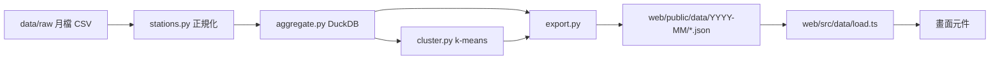

# Architecture Spine — 城市呼吸

> Fast path 草稿：決策已依 PRD 與 2026-09 實際資料驗證，標 `[ASSUMPTION]` 者待 Piwi 確認。

## Design Paradigm

Pipes-and-filters：原始月檔 → 正規化 → 彙總 → 分群／異常 → 匯出靜態 JSON。網站是唯讀的消費端，沒有後端。



依賴方向只能由左到右；`web/` 不得 import `pipeline/` 任何東西，兩邊只共用資料契約。

## Invariants & Rules

### AD-1 — 靜態資料契約是唯一介面 [ADOPTED]
- **Binds:** all
- **Prevents:** 前端各畫面各自處理原始資料、出現不同數字
- **Rule:** 網站只讀 `web/public/data/{month}/` 下的 JSON。每檔帶 `v`（契約版本），`load.ts` 版本不符就報錯。改欄位＝改 `docs/data-contract.md`＋`export.py`＋`types.ts`，三者同一個 commit。

### AD-2 — 站名正規化只在管線
- **Binds:** 所有用到車站的功能
- **Prevents:** 「O景安／景安」「G大坪林／大坪林」被當成不同站
- **Rule:** 別名寫在 `pipeline/config/station_aliases.csv`；站 ID = `s` + sha1(正規站名) 前 8 碼。前端只用 ID 與陣列索引。

### AD-3 — 少於 10 人在管線端隱藏 [ADOPTED]
- **Binds:** US-1、US-2、任何起訖數字
- **Prevents:** 前端各自決定門檻、或從其他數字反推小數字
- **Rule:** 起訖平均四捨五入後 < 10 一律輸出 `null`，前端顯示「少於 10 人」。站層級總量不受此限。

### AD-4 — 日型定義
- **Binds:** 平日／假日切換、所有平均
- **Rule:** 週六、週日與 `config/holidays.csv` 列出的日子為 `holiday`，其餘為 `weekday`。假日表每月更新；異常候選（daily.json）可協助發現漏列的假日。

### AD-5 — 停止營運不是 0
- **Rule:** 小時陣列固定 24 格；資料中沒有的時段（目前 2–4 點）為 `null`，畫面顯示「停止營運」。

### AD-6 — 起訖表依起站分片
- **Rule:** `od/{stationId}.json` 只在使用者選了起站才載入（約 25 KB）；首頁只載 `stations.json` 與 `flows.json`（合計約 190 KB）。

### AD-7 — 平均的分母
- **Rule:** 平均 = 該月該日型總人次 ÷ 該日型天數（沒人搭的日子算 0）。

### AD-8 — 視覺走 token，設計依 hallmark
- **Rule:** 所有顏色、字型只透過 `:root` token；deck.gl 圖層用 `tokenRgb('--token')` 讀取，不寫死 RGB。設計流程使用 `.claude/skills/hallmark`。

## Consistency Conventions

| Concern | Convention |
| --- | --- |
| 命名 | JSON 欄位 camelCase；Python snake_case；檔名 kebab／小寫 |
| 時間 | 月份 `YYYY-MM`；日期 ISO `YYYY-MM-DD`；小時 0–23 整數 |
| 站的參照 | 檔案內用 `stations.json` 的陣列索引；跨檔／URL 用站 ID |
| 文案 | 繁體中文；人數加千分位＋「人」；資料來源與月份須出現在分享卡與來源頁 |
| 錯誤 | 載入失敗顯示可讀訊息，不出現空白畫面 |

## Stack

| Name | Version |
| --- | --- |
| Python | ≥ 3.12（uv 管理） |
| DuckDB | 2.0.0 |
| scikit-learn | 1.9.1 |
| React | 19.3.1 |
| Vite | 8.3.5 |
| TypeScript | 7.0.2 |
| maplibre-gl | 6.16.0 |
| deck.gl（core／layers／mapbox） | 9.4.0 |
| Vitest | 5.0.5 |
| 部署 | Vercel 靜態網站 [ASSUMPTION] |

## Structural Seed

```text
city-breath/
  pipeline/            # Python 彙總管線（uv）
    config/            # 別名、假日、顯示名、（之後）車站類型定名
    src/city_breath_pipeline/
    tests/
  data/raw/            # 原始月檔（不進 git）
  web/                 # Vite + React 靜態網站
    public/data/       # 管線輸出（進 git，網站直接讀）
    src/data/          # 契約型別、載入、純運算（可測）
    src/map/           # 地圖與 deck.gl 圖層
  docs/data-contract.md
```

## Capability → Architecture Map

| Capability | Lives in | Governed by |
| --- | --- | --- |
| US-3 城市呼吸首頁 | web/src/map、flows.json、stations.json | AD-1、AD-5、AD-8 |
| US-1／US-2 通勤同路人卡 | web/src/data/commute.ts、od/{id}.json | AD-3、AD-6 |
| US-4 車站個性卡 | pipeline/cluster.py、stations.json | AD-2、AD-4 |
| US-5 城市異常時刻（P1） | daily.json anomalyCandidates | AD-4 |

## Deferred

- 底圖圖磚來源與樣式：hallmark 設計階段決定；加圖磚前需修 maplibre v6 worker 打包問題。
- 搭乘站數（通勤負擔地圖，P1）：需要路網圖，P1 再加 `network.json`。
- 多月份（近 12 個月）彙總與月份切換：契約已有 `months.json`，UI 之後做。
- 分享卡圖片輸出方式（canvas 繪製或 DOM 轉圖）：設計定稿後決定。
- 每月自動重跑排程：先手動，穩定後再上 GitHub Actions。
