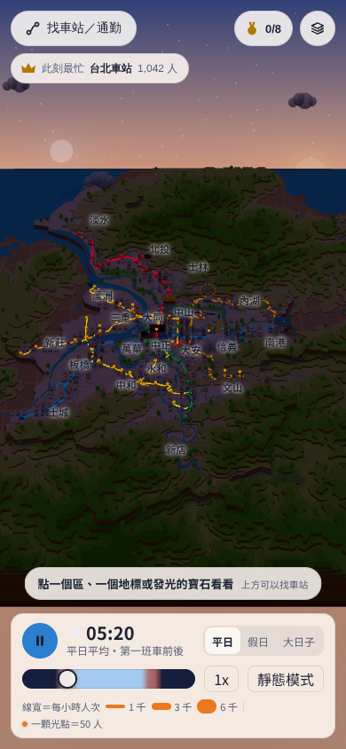
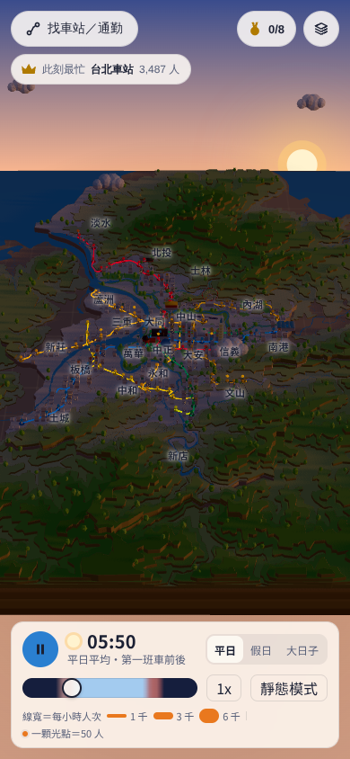
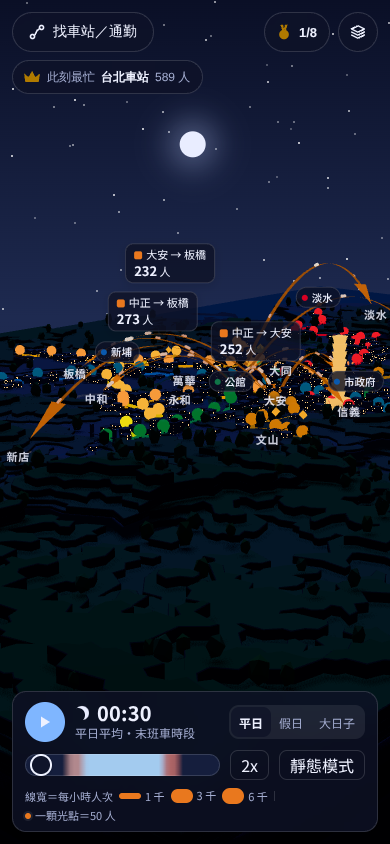
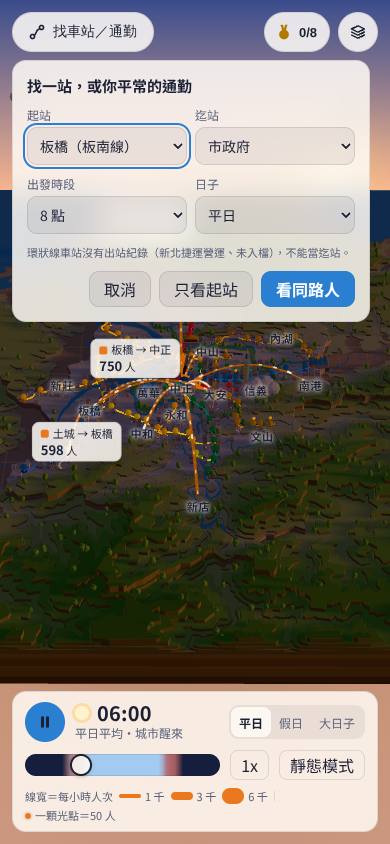
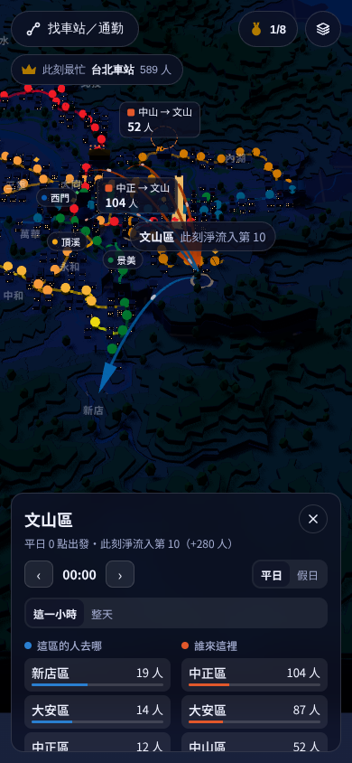
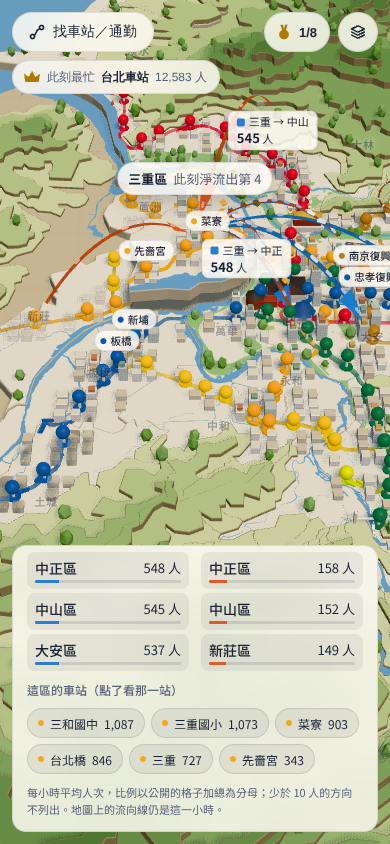
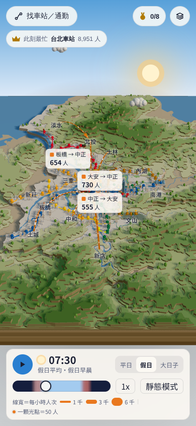
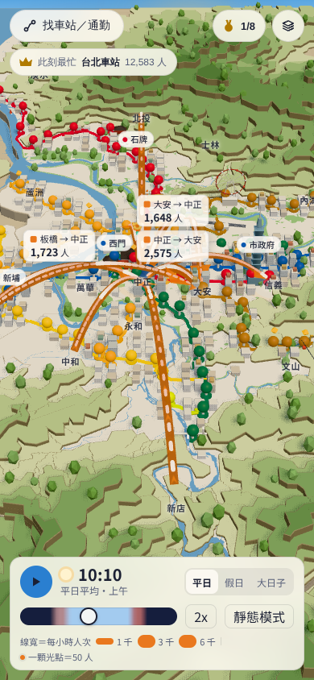
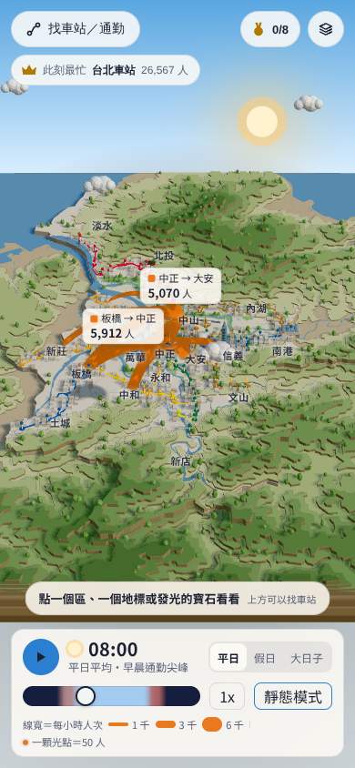
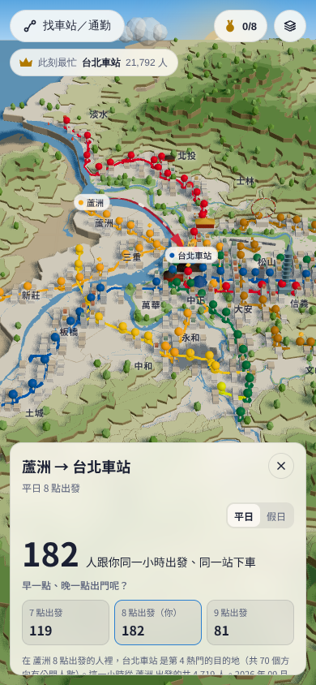

# 2.1 原型：第一次使用者走查（2026-11-11）

對象：`design/prototypes/2.1-diorama/`（第四輪，天光）。
方法：請一位完全不知道這個網站的使用者（subagent 扮演，手機 390×844）自己摸索，不給任何說明，邊用邊說出想法；另外用「減少動態」再走一次開場。截圖選了 10 張放在 `design/reviews/2.1-first-time-user/`。
和 2026-11-10 的走查不同：上一次是照 user story 逐條走「做不做得到」，這一次看的是「第一次來的人看不看得懂、找不找得到」。

嚴重度：**blocker**＝第一次來的人會卡住或直接離開；**主要摩擦**＝做得到但會迷路、誤會或放棄一半；**小問題**＝看得出來但不影響完成。
每一條都對到一張票，或寫明為什麼不做。票號以 2026-11-11 replan 之後為準（4.5 移成 3.16、6.1 移成 3.17）。

## Piwi 的決定（2026-11-11）

1. 開場維持從清晨開始自動播放（不改）。
2. 鏡頭改成地圖習慣：單指平移、雙指縮放＋旋轉／傾斜、傾角上下限、縮放朝手指、「回到全景」鈕（3.5，DESIGN.md 互動、diorama-game-juice 鏡頭規則）。
3. 分享入口與網站說明提前做，排在 3.6／3.12 之後；網站說明包括網站名＋一句話、提示等使用者點了才消失、固定的「關於／資料來源」入口。
4. 新增「假日熱門 5 站／5 區」與「怎麼看這張圖」兩張票；不開「車站卡分享」。
5. 其他發現落到既有票（見下表）。

## Blocker

| 編號 | 問題 | 截圖 | 票 | 處理 |
| --- | --- | --- | --- | --- |
| B1 | 找不到任何分享入口；網址不記狀態，貼給朋友打開又回到清晨的全城 | — | 3.15、3.16、4.2、7.7、3.3、4.4 | 3.15 新增分享入口（每張卡的分享鈕＋沒開卡時的「分享這一刻」），網址記站、行政區、時段、平假日並能還原；3.16 行政區卡存成圖；通勤卡（4.2）與活動卡（7.7）接同一個入口；3.3 已負責時段與日型進網址；4.4 計數連結分享 |
| B2 | 開場沒有網站名、一句話說明，也沒有「關於」；提示約 10 秒就自己消失，沒看到就沒了 |   | 3.11、3.17 | 3.11 改成開場說明：網站名＋一句話，提示等使用者點了任何東西才收起；3.17 固定的「關於／資料來源」入口，任何時候一點就到 |

## 主要摩擦

| 編號 | 問題 | 截圖 | 票 | 處理 |
| --- | --- | --- | --- | --- |
| F1 | 讀卡片時時間自己往下跑，數字跟著變，讀到一半就不是剛剛那個時段 | — | 3.6、3.12 | 任何小卡打開就暫停播放，卡上標明「平日 8 點」這類時段與日型；3.6 做在共用卡框裡，3.12 驗收 |
| F2 | 單指拖曳是翻轉鏡頭；翻斜之後救不回來（只剩天空或貼地）；沒有回到全景；雙指縮放不朝手指 |  | 3.5 | Piwi 決定 2：地圖習慣的手勢、傾角上下限、縮放朝手指、「回到全景」鈕；寫進 DESIGN.md 互動與 diorama-game-juice 鏡頭規則 |
| F3 | 找車站只能用下拉選單，依行政區分組、區沒有順序，中山站在「大同區」底下找不到；預設的板橋→市政府跟使用者無關 |  | 4.1 | 打字搜尋之外，清單改依路線分組（站序照路線），加最近用過的站（先只記這次造訪，跨次保存要改 AD-22，待 Piwi）；起訖預設留空或帶入目前選的站，不放無關的站。站的行政區不改：中山站出口在大同區，由 1.8 依官方界線判定（AD-9），改成依路線分組後使用者不必知道區 |
| F4 | 寶石太小點不到，常點到後面的行政區；收集冊的勳章列點了沒反應 |  | 3.9 | 寶石放大並發光，點擊範圍至少 44px，且優先於行政區；點勳章列鏡頭飛到寶石附近（不直接開答案，提示保持容易） |
| F5 | 橘色和藍色在不同畫面意思不同（全城的橘、去哪的藍、誰來的橘紅），畫面上沒有說明 |  | 3.3、3.6、3.19 | 3.3 的圖例跟著模式換字（全城／去哪／誰來）；3.6 行政區卡標明兩種顏色；3.19「怎麼看這張圖」在場景裡示範，原型順便比較全城色要不要和「誰來」拉開 |
| F6 | 想知道「假日大家都去哪」，切到假日只看到流向在動，沒有直接答案 |  | 3.18 | 新增「假日熱門 5 站／5 區」：假日時一點就看到人最多與比平日熱鬧的站和區，點了開那張卡 |
| F7 | 資料來源散在各張卡片底部的小字，找不到也讀不完 | — | 3.17 | 併入「關於／資料來源」：卡片底部只留一行「資料：2026 年 9 月・來源 ›」連到關於 |
| F8 | 放大後流向緞帶粗到蓋住街區；弧頂的人數標籤被上方 HUD 壓住或被畫面邊緣切掉 |  | 3.5 | 緞帶的螢幕寬度設上限，放大時不蓋住街區；標籤避開 HUD 與畫面邊緣，放不下就收進最近的緞帶旁 |

## 小問題

| 問題 | 截圖 | 票 | 處理 |
| --- | --- | --- | --- |
| 「靜態模式」按了看不出差別 |  | 3.3 | 按了要有看得到的改變（停止播放、跳到 8 點、光點換成光帶），按鈕顯示目前狀態 |
| 皇冠幾乎永遠在台北車站；名牌上的人數和車站卡對不上 | — | 3.10 | 名牌人數用整點的值、標明「進出」，等於車站卡同一小時的進＋出（播放中不內插）；名牌點開先列此刻前 3 名（Sofia 的建議，待 Piwi 確認），不改皇冠的判定 |
| 行政區卡的站名後面只有數字、沒有單位 |  | 3.6 | 標明「此刻進出 N 人」 |
| 通勤的時段選單沒有 2–4 點，時間軸卻有 | — | 4.1 | 選單列出 2–4 點但標「停止營運」不能選，和時間軸一致 |
| 活動卡大標題寫 16 點，卡內時間選擇器是 14:00 | — | 7.4 | 卡上所有寫到小時的地方都跟同一個 hour；散場高峰另外標「散場高峰 N 點」 |
| 從通勤選到得主站不會解鎖勳章 | — | 3.9 | 從地圖、找車站、通勤起訖、皇冠、地標選到那站都算解鎖 |

## 做得好的（保留）

| 觀察 | 截圖 | 怎麼保留 |
| --- | --- | --- |
| 沙盤很美，第一眼就想玩 |  | 照 DESIGN.md 天光，3.5、3.13、3.14 移植時對照原型 |
| 車站「個性」的文案讓人想多點幾站 | — | 3.12 照原型移植；類型與一句話由 5.1 加 |
| 同路人卡與「早一點、晚一點出門呢？」一看就懂 |  | 4.2 照原型 |
| 大日子（演唱會那天多了多少人）很有話題 | — | 7.4 照原型 |
| 減少動態版從 8 點開場，反而更快看懂 |  | 不改開場（Piwi 決定 1：維持清晨自動播放）；改由 3.11 的開場說明和 3.19 的導覽幫第一次來的人看懂 |

## 不做的

- 開場改成從 8 點、不自動播放：Piwi 決定 1，維持從清晨自動播放。
- 車站卡分享：Piwi 2026-11-11 說先不用。
- 改中山站的行政區：站的行政區只由管線依官方界線判定（AD-9，1.8 已完成）；用依路線分組的找車站解決找不到的問題。

## 截圖

| 檔案 | 內容 |
| --- | --- |
| `01-open-5s.png` | 開場 5 秒：沒有網站名，只有一行提示 |
| `02-hint-gone-10s.png` | 開場 10 秒：提示已經消失 |
| `03-camera-tilted.png` | 單指拖曳把鏡頭翻斜，只剩貼地的一角，救不回來 |
| `04-zoom-ribbons.png` | 放大後緞帶蓋住街區，標籤被 HUD 壓住、被邊緣切掉 |
| `05-station-picker.png` | 找車站是下拉選單，預設板橋→市政府 |
| `06-gem-hits-district.png` | 想點寶石，點到了文山區 |
| `07-holiday.png` | 切到假日：流向在動，但沒有「大家去哪」的答案 |
| `08-district-card-numbers.png` | 行政區卡：站名後的數字沒有單位，藍橘兩色沒有說明 |
| `09-companions-good.png` | 同路人卡與早晚一小時比較（做得好） |
| `10-reduced-motion-8am.png` | 減少動態：停在 8 點，「靜態模式」按下後看不出差別 |
